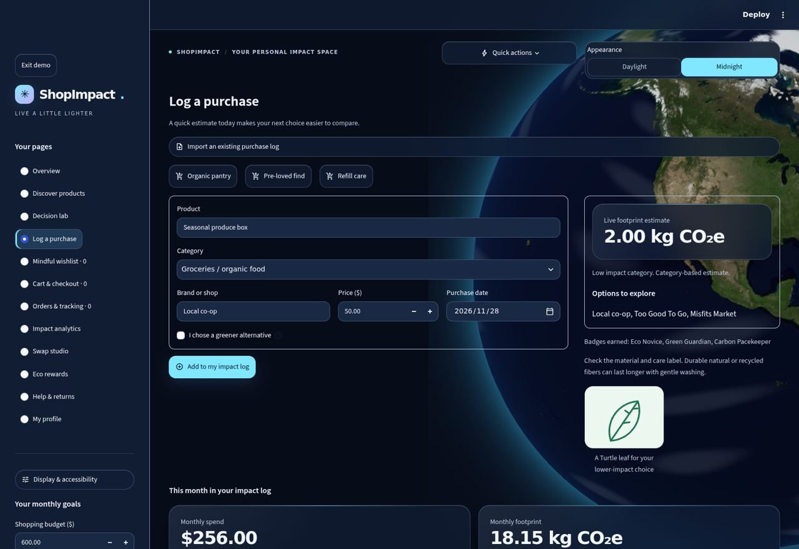

<div align="center">


# ShopImpactAI

### Why I built ShopImpactAI

I built ShopImpactAI to help me pause before I buy something, understand its estimated impact, and decide whether it fits my budget and needs.

[](https://github.com/sritharan-blip/IDAI102-1000526-ShopImpactAI-Sritharan/actions/workflows/tests.yml)


[My live Streamlit app](https://shopimpactai-sritharan.streamlit.app/) · [My design and testing](docs/DESIGN_AND_TESTING.md)

[What I built](#what-i-built) · [How I run it locally](#how-i-run-it-locally) · [How I make recommendations and estimates](#how-i-make-recommendations-and-estimates) · [How I organized the code](#how-i-organized-the-code) · [My classmate feedback](#my-classmate-feedback)

</div>

---

## What I built

I designed the dashboard so I can track my spending, see my estimated footprint, and find products that fit what I’m looking for.

<picture>
  <source media="(prefers-color-scheme: dark)" srcset="assets/screenshots/midnight-overview.jpg">
  
</picture>

<p align="center"><sub>I captured my demo ledger in Chrome using the Daylight and Midnight themes.</sub></p>

<details>
<summary><strong>How I show Midnight and Decision lab</strong></summary>




I captured the purchase flow after saving a sample grocery purchase in my Chrome test.

</details>

| Feature | How I use it |
| :--- | :--- |
| **Liquid glass** | I switch between Daylight and Midnight. I used frosted layers, floating cards, and a 3D Earth backdrop with a different angle on each page. |
| **Orbit, my Earth mascot** | I drag Orbit to spin it and double-tap to make it celebrate. I use its expression, colors, and haze to see how my monthly estimate compares with my goal. |
| **Purchase logging** | I check my footprint estimate and alternatives as I enter my purchase details. I show an animated Python Turtle leaf when I log a lower-impact choice. |
| **Monthly dashboard** | I use my current session data to follow spending, category estimates, lower-impact choices, goals, and recent activity. |
| **Smart matches** | I describe what I need and review locally ranked demo products. I use text similarity, category, budget, and estimated reductions to explain each pick. |
| **Decision lab** | I check cost per use and budget fit, then save a pause plan for tomorrow, three days, or next week. |
| **Wishlist** | I separate needs from wants, add notes, and decide when to revisit each idea. |
| **Demo shopping** | I explore products, a cart, simulated checkout, orders, returns, rewards, and analytics in one session. |

I designed the animations to follow my operating system’s reduced-motion setting. I can also pause animations under **Display & accessibility → Reduce motion** or choose **High contrast**.

I use one active palette for text, fields, controls, and backgrounds. I keep the motion in the glass and lighting effects so I can read the text during theme changes.

<details>
<summary><strong>How I use all 12 pages</strong></summary>

| Page | What I do there |
| :--- | :--- |
| Overview | I check my monthly snapshot, goals, footprint trend, and activity. |
| Discover | I search and filter products, open details, and review why I got each match. |
| Decision lab | I check my budget and cost per use, then save a pause plan. |
| Log a purchase | I log purchases, search for exact text, and import or export CSV files. |
| Wishlist | I mark needs and wants, jot down notes, estimate the cost, and set revisit dates. |
| Cart & checkout | I adjust quantities, check totals, and try the simulated checkout. |
| My orders | I follow demo orders and tracking stages. |
| Impact analytics | I compare spending and footprint by category and track progress against my budget. |
| Swap studio | I compare lower-impact scenarios and save alternatives in a comparison basket. |
| Eco rewards | I check milestones, progress, and weekly challenges. |
| Help & returns | I try sample return and support forms in my session. |
| Profile | I manage my profile and choose whether to use purchase history for recommendations. |

</details>

> I built this as a prototype. I simulate shopping, ratings, availability, checkout, tracking, returns, and support. I use carbon estimates for approximate comparisons.

## How I run it locally

I use **Python 3.10 or later**. I choose **Explore the demo** from the sign-in screen to try the app in a temporary session. I use the same demo on my live app.

<details open>
<summary><strong>Windows PowerShell</strong></summary>

```powershell
git clone https://github.com/sritharan-blip/IDAI102-1000526-ShopImpactAI-Sritharan.git
cd IDAI102-1000526-ShopImpactAI-Sritharan
py -m venv .venv
.\.venv\Scripts\Activate.ps1
python -m pip install -r requirements.txt
python -m streamlit run ShopImpactAI.py
```

If PowerShell blocks activation, I run the virtual environment’s Python directly.

```powershell
.\.venv\Scripts\python.exe -m pip install -r requirements.txt
.\.venv\Scripts\python.exe -m streamlit run ShopImpactAI.py
```

</details>

<details>
<summary><strong>macOS / Linux</strong></summary>

```bash
git clone https://github.com/sritharan-blip/IDAI102-1000526-ShopImpactAI-Sritharan.git
cd IDAI102-1000526-ShopImpactAI-Sritharan
python3 -m venv .venv
source .venv/bin/activate
python -m pip install -r requirements.txt
python -m streamlit run ShopImpactAI.py
```

</details>

I open the local address from my terminal, usually `http://localhost:8501`. I choose **Load demo data** to populate my dashboard and press **Ctrl+C** to stop the server.

On Streamlit Community Cloud, I select this repository, the `main` branch, and `ShopImpactAI.py` as my main file.

<a id="enable-email-accounts-and-cloud-saves"></a>

### How I set up email accounts and cloud saves

1. I set up a hosted PostgreSQL database and run [`tools/cloud_schema.sql`](tools/cloud_schema.sql) as the database owner. I give the dedicated runtime role `USAGE` on `shopimpact_private`, plus `SELECT`, `INSERT`, and `UPDATE` on its tables. I keep that schema outside any public data API.
2. I copy [`.streamlit/secrets.example.toml`](.streamlit/secrets.example.toml) into **Settings → Secrets** and enter the runtime role’s connection string. If I receive a database CA certificate from my provider, I enter its PEM text as `ca_certificate` so I can verify the connection. On Supabase I use the **Session pooler** connection details.
3. I restart the app, create a test account, and add a purchase. I sign in again in a fresh session to check that I can recover the purchase. I sign in to a second test account to confirm I see a separate workspace.

I create an account with my name, email, and password. I store a salted scrypt hash in the database. I stay signed in for the current browser session and can reopen my saved workspace the next time I sign in. I can set `SHOPIMPACT_REQUIRE_ACCOUNT=1` to limit access to signed-in accounts.

## How I make recommendations and estimates

### How I rank products locally

I use **TF-IDF** to represent the built-in catalog and cosine similarity to compare it with my shopping intent. I also rank by category affinity and estimated reduction, and I filter by the selected category and maximum budget.

If I leave my shopping intent blank, I can use recent purchases to personalize my ranking. I can turn that off in **Profile**. I use the score to rank products in my demo catalog.

### How I calculate the estimates

```text
Category estimate (kg CO2e) = category factor × price ÷ 10
Estimated reduction (kg CO2e) = max(0, recorded baseline − recorded footprint)
Cost per use ($) = price ÷ (uses per week × 52 × years kept)
```

At demo checkout, I record the product factor and the category-average baseline. When I choose a greener scenario manually, I use an assumed factor of up to 0.4 kg CO2e per $10. In Decision lab, I enter my own assumptions about how often I’ll use an item and how long I’ll keep it.

<details>
<summary><strong>The category factors I use</strong></summary>

| Category | Estimated kg CO2e per $10 |
| :--- | ---: |
| Electronics | 3.5 |
| Fast fashion / leather | 2.8 |
| Groceries / organic food | 0.4 |
| Sustainable apparel / second-hand | 0.2 |
| Beauty & personal care | 1.1 |
| Home & living | 1.5 |

I use these broad factors to compare purchases. I treat the results as approximate because actual footprints depend on materials, manufacturing, location, transport, energy sources, and how the estimate was made.

</details>

## How I store my data

In **demo mode**, I keep my data in Streamlit session state. I can lose it when my session ends or the server restarts. I download a backup to keep my ledger and wishlist.

When I enable **account storage**, I save my ledger, wishlist, cart, demo order history, saved swaps, comparison basket, goals, and display and recommendation preferences to my PostgreSQL workspace. I keep temporary support and return requests, local profile fields, and demo delivery details in the current session. I check the cloud revision to prevent changes from one tab overwriting changes in another.

| Tool | What I import or preserve |
| :--- | :--- |
| CSV import | I require `product`, `category`, and `price`, and accept optional ISO `date` and `brand`. I recalculate emissions from category and price. |
| JSON backup v2 | I preserve my ledger, wishlist, footprints, baselines, identifiers, and wishlist dates. |
| Legacy v1 restore | I keep recorded CO2 snapshots where available, discard the ambiguous `green_savings` field, and recalculate reductions from the footprint and baseline. |

I cap CSV imports at **5 MB / 5,000 rows** and report any invalid rows I skip. I support backups up to **5 MB, 5,000 purchases, and 500 wishlist ideas**. I reject invalid backups and retain the current data. I omit profile, cart, orders, support requests, and display preferences from backup files.

<details>
<summary><strong>An example CSV I can import</strong></summary>

```csv
date,product,category,brand,price
2026-01-15,Refill hand wash,Beauty & personal care,Ethique,18.00
2026-01-16,Second-hand reading lamp,Home & living,Etsy (vintage),35.00
```

I use category names from the factor table, dates in `YYYY-MM-DD` format that are no later than today, and finite, non-negative prices. I ignore any `co2` column in an imported CSV.

</details>

I keep purchases and profile details within the app and its configured database. I keep credentials, virtual environments, browser profiles, and private data out of my commits.

## How I organized the code

| Layer | Where I put it |
| :--- | :--- |

| Entry point & navigation | `ShopImpactAI.py`, `shopimpact/app.py` |
| Glass, motion & appearance tokens | `shopimpact/theme.py`, `shopimpact/assets/app.css` |
| Orbit's 3D renderer | `shopimpact/earth.py`, `shopimpact/assets/earth.js` |
| Account sign-in and cloud saves | `shopimpact/accounts.py`, `shopimpact/cloud.py`, `tools/cloud_schema.sql` |
| Reusable visual components | `shopimpact/ui.py` |
| Purchase math & catalog | `shopimpact/logic.py`, `shopimpact/catalog.py` |
| Local recommendation model | `shopimpact/recommendations.py` |
| Decision lab | `shopimpact/decisions.py` |
| Imports & snapshot backups | `shopimpact/data.py` |
| Feature views | `shopimpact/marketplace.py`, `ledger.py`, `insights.py`, `wishlist.py` |
| Reproducible animated cover | `tools/generate_banner.py` |
| Python Turtle artwork | [`tools/generate_eco_leaf.py`](tools/generate_eco_leaf.py), [`tools/turtle_demo.py`](tools/turtle_demo.py) |

I built the interface with Streamlit and Plotly. I use pandas for ledger summaries and Pillow with NumPy to generate the animated cover. I serve the artwork locally.

I use a locally served 2048 × 1024 satellite map from [NASA Earth Observatory's Blue Marble: Next Generation](https://science.nasa.gov/earth/earth-observatory/blue-marble-next-generation/base-map/), produced by Reto Stöckli at NASA Goddard Space Flight Center. I use the [resized JPEG](https://github.com/MaxwellLee/physics-lab/blob/main/assets/textures/SOURCES.md#earth) from the Physics Lab project.

### How I run my Python Turtle animation

I use Python Turtle to trace and export the leaf I animate in Streamlit. I regenerate the web asset with `python tools/generate_eco_leaf.py`. I add `--preview` to open the same drawing in a desktop window with Tk installed.

I use a separate desktop animation to show how I check the budget, estimate cost per use, and save a pause plan. I run it from the repository root with Python and Tk installed.

```bash
python tools/turtle_demo.py
```

I press **Space** to play or replay the animation and **Esc** to close it.

### How I test the app

```bash
python -m compileall -q ShopImpactAI.py shopimpact tools tests
python -m unittest discover -s tests -v
```

I check live estimates, monthly totals, badges, and Turtle artwork with 12 mixed purchases in my [design and testing record](docs/DESIGN_AND_TESTING.md#how-i-tested-twelve-purchases). I use GitHub Actions to test Python **3.10, 3.12, and 3.14**. I use Chrome to check theme switches, text and background contrast, dropdowns, forms, mobile layout, and reduced motion. I save screenshots from that run as artifacts.

To run my browser checks locally, I install Google Chrome and Playwright.

```bash
python -m pip install playwright
python tests/browser_smoke.py
```

I rebuild my animated cover with `python tools/generate_banner.py`.

<a id="classmate-feedback"></a>

## My classmate feedback

I’m preparing six usability tests for ShopImpactAI. I listed Adrian and Kavin as reviewers and added four placeholder names. I’m keeping all review dates and responses pending until I collect actual feedback.

| Reviewer | Review date | What I want to check | Feature I implemented |
| :--- | :--- | :--- | :--- |
| Adrian | Pending | I want to check whether I can log a purchase and see its footprint without doing the math. | I calculate an estimated footprint from the category and price in **Log a purchase**. |
| Kavin | Pending | I want to check how quickly I can find the category with the biggest footprint. | I show estimated CO₂e by category in **Impact analytics**. |
| Rohan | Pending | I want to see whether I can compare a purchase with a lower-impact alternative. | I compare scenarios and save alternatives in **Swap studio**. |
| Diya | Pending | I want to check whether I can estimate cost per use and give myself time to think. | I calculate cost per use in **Decision lab** and save pause plans with a revisit date in **Wishlist**. |
| Nikhil | Pending | I want to check whether I can understand why a product matched my shopping intent. | I show product suggestions and explain the matches in **Discover**. |
| Meera | Pending | I want to check whether I can tell from Orbit when I’m close to my monthly footprint goal. | I use Orbit’s expression, colors, and haze to show when my monthly estimate approaches or exceeds my goal. |

I use my [six-person usability feedback record](docs/USABILITY_FEEDBACK.md) to track tasks, ratings, comments, and changes after testing.


---

<div align="center">

I built ShopImpactAI as [sritharan-blip](https://github.com/sritharan-blip).

</div>
