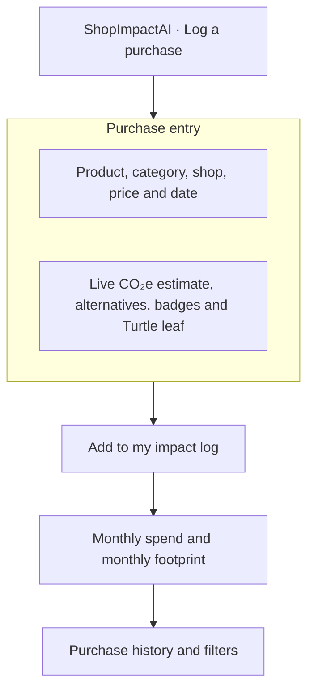

# How I designed and tested ShopImpactAI

I chose Scenario 1, the Sustainable Shopping Logger. I wanted to connect everyday spending with an estimated carbon footprint and show an alternative I could try on my next purchase.

## What I wanted to solve

| Who I designed for | What I wanted to make easier | How I wanted the interaction to feel |
| :--- | :--- | :--- |
| Students on a budget | I wanted to check the price and compare a second-hand option without working out emissions by hand. | I wanted to feel curious about a cheaper option and confident enough to try it. |
| Young adults shopping online | I wanted to look back at impulse purchases and check which categories added up fastest. | I wanted to pause and reflect without feeling judged. |
| People tracking household spending | I wanted to spot recurring categories without comparing a pile of receipts. | I wanted a clear monthly summary and a realistic goal I could work toward. |

I started each decision with four questions. What did I buy, what did it cost, what is its estimated footprint, and what could I try next time?

## How I arranged the app

I drew this wireframe to document the layout I implemented. I keep the purchase fields and live estimate together near the top, put rewards and suggestions next to the fields, and put results below the save action. I use the separate **Overview** page for the monthly snapshot and charts. At a narrow width I stack the controls and previews in reading order.

I use ocean blue and foliage green to connect the app to the Earth artwork. I use light, warm neutral surfaces for the Daylight dashboard and navy backgrounds for Midnight. I pair colors with written impact levels, readable numbers, and badge status labels. I keep text labels visible on form controls and give myself high-contrast and reduced-motion options in the sidebar.

## How I implemented the requirements

| What I needed | Where I implemented it |
| :--- | :--- |
| Saved purchase details | I store a list of dictionaries with each product, category, brand or shop, price, date, estimated footprint, and baseline. [Ledger and data](../shopimpact/ledger.py) |
| Category-based estimate | I multiply price by the category factor per dollar. My factors are expressed per $10, so I divide by ten. My $100 electronics example gives 35.00 kg CO₂e. I get 4.00 kg CO₂e when I explicitly model a lower-factor alternative. [Calculation](../shopimpact/logic.py) |
| Progress clues and rewards | I check lower-impact choices, the monthly target, and estimated savings. I draw a leaf with Python Turtle commands, export its strokes, and animate those strokes beside the estimate after I save a lower-impact choice. [Badge logic](../shopimpact/logic.py) · [Turtle drawing](../tools/generate_eco_leaf.py) |
| Category alternatives | I show alternative brands, resale options, or other shopping routes for every category. I use **Swap studio** to compare scenarios. [Alternatives catalog](../shopimpact/catalog.py) |
| Monthly dashboard | I use **Overview** for spend and footprint totals. I repeat both totals below the purchase controls and refresh them on save. I use **Impact analytics** for category comparisons. |
| Creative features | I rotate eco tips after logging a purchase. I compare cost per use in **Decision lab**, visualize monthly progress with Orbit, and keep an account-free demo for quick testing. |

I treat category factors and savings as rough estimates. I use brand suggestions as examples to investigate and leave certification claims out of my badge logic. I keep sample purchases and fictional checkout details in my demo. For reproducible results, I use USD in every test amount.

## How I tested twelve purchases

I ran the purchase entry flow with low and high prices, all six categories, and both ordinary and modeled greener choices. I checked that the estimate changed before I hit **Add to my impact log**, the balance changed immediately after saving, and a qualifying choice showed the Turtle leaf. I included two previous-month entries to check the monthly cutoff.

| Sample purchase | Price | Estimate checked (kg CO₂e) | What I expected to see |
| :--- | ---: | ---: | :--- |
| Pantry refill | $5 | 0.20 | I see the leaf for a grocery purchase. |
| Used jacket | $45 | 0.90 | I see the leaf for a second-hand purchase. |
| Refurbished phone | $110 | 4.40 | I see the lower-factor estimate and leaf. |
| New headphones | $220 | 77.00 | I see the electronics estimate. |
| Leather shoes | $100 | 28.00 | I see the fashion estimate. |
| Refill shampoo | $20 | 0.80 | I see the lower-factor estimate and leaf. |
| Desk lamp | $70 | 10.50 | I see the home and living estimate. |
| Market apples | $4 | 0.16 | I see a small grocery estimate and the leaf. |
| Used shirt | $10 | 0.20 | I see a second-hand estimate and the leaf. |
| Co-op oats | $15 | 0.60 | I see a grocery estimate and the leaf. |
| Previous-month tablet | $250 | 87.50 | I see my current-month totals stay the same. |
| Previous-month tote | $20 | 5.60 | I see my current-month totals stay the same. |

I checked a current-month total of **$599.00** and **122.76 kg CO₂e**. I checked that **Green Guardian** and **Eco Saver of the Month** unlocked while **Carbon Pacekeeper** stayed in progress. [Automated purchase checks](../tests/test_app.py)

## What I improved after checking the app myself

I moved the estimate above the save action because I could only compare choices after committing them. I added examples beside the estimate so I could consider a swap without leaving the entry page. I connected my Turtle drawing to a qualifying purchase and made the demo accessible from my sign-in page for assessment testing.

I keep dates, ease ratings, and changes from independent testing in my [classmate feedback record](USABILITY_FEEDBACK.md).
